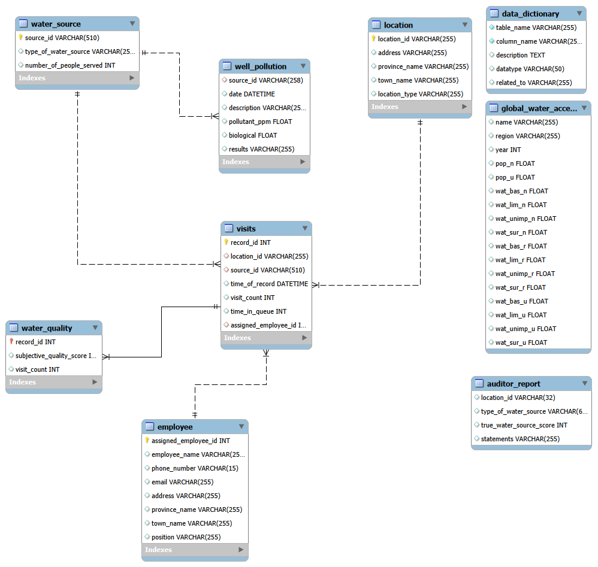

# Maji Ndogo Water Services: SQL Analysis

A four part SQL project on a simulated national water access survey. I clean the data, find patterns in who has water and who queues for it, check the data against an independent audit, and turn the findings into a job list for repair engineers.

Built with MySQL and MySQL Workbench as part of the ALX Data Analytics program. The country, the people and the dataset are fictional.

## The problem

Maji Ndogo is a fictional country where water access is uneven. A survey of more than 60,000 records covers water sources, the people they serve, how long people queue and how clean the water is. The questions:

- Where do people get their water, and which sources serve the most people?
- Where are the biggest problems: long queues, contaminated wells, broken infrastructure?
- Can the survey be trusted?
- Which sources should repair teams visit first, and what should they do there?

## Data model

`visits` is the central table. It links each record to a location, a water source and the employee who recorded it. `water_quality` is one to one with `visits`. Wells have extra data in `well_pollution`. An `auditor_report` table is added in Part 3.

The dataset is course material and is not included in this repository. Restore the `md_water_services` database from the ALX files and import the auditor report CSV in Part 3.

## What each part does

| Part | Script | What happens |
|---|---|---|
| 1 | `01_explore_and_clean.sql` | Explore the tables, check data quality, fix the well pollution data (wrong descriptions, wells marked clean despite biological contamination) |
| 2 | `02_analysis.sql` | Clean employee contact data, count people served per source type, rank sources with window functions, find when queues are longest with a CASE pivot |
| 3 | `03_data_integrity_and_investigation.sql` | Compare the auditor's scores with the surveyors' scores, build the `Incorrect_records` view, find employees with an above average number of mistakes |
| 4 | `04_action_plan.sql` | Build `combined_analysis_table`, pivot access by province and town, create `Project_progress` and fill it with 25,398 jobs for the engineers |

## Key findings

- **Shared taps are the biggest problem.** 43% of people depend on them, about 2,000 people per tap, with the longest queues.
- **Queues peak on Saturday.** The average wait is 246 minutes, about twice a weekday. Mornings and evenings are the busiest hours every day. Sunday has the shortest queues.
- **Most sources are rural** (about 60%), so repairs mean long distances and limited supplies.
- **Broken infrastructure hides behind home taps.** 45% of people with a home tap have one that does not work. In Amina (Amanzi) it is 95%.
- **River water is concentrated in Sokoto.** Rural Sokoto, Bahari and Kofi have the highest river share, so drilling crews start there.
- **The survey is largely reliable.** The auditor agreed with the surveyors on 1,518 of 1,620 sites (94%). The 102 disagreements come from 17 employees, and four of them are above the average. That is a reason to review those records, not proof of anything.
- **The plan covers 25,398 sources.** Wells need the most jobs (12,467 filters), then broken home taps (5,856), shared taps with queues over 30 minutes (3,696) and rivers (3,379). Shared taps come first by impact, because they serve the most people.

## How to run it

1. Restore the `md_water_services` database in MySQL 8.0.16 or later (the `CHECK` constraint in Part 4 needs it).
2. Run the scripts in order, 01 to 04. Each one builds on the one before.
3. In Part 3, import the auditor CSV into `auditor_report` with the Table Data Import Wizard when the script reaches that step.

Things to know before running:
- Parts 1 and 2 change data in `well_pollution` and `employee`. Part 3 only adds objects. Part 4 adds new objects and no existing data changes.
- `town_aggregated_water_access` in Part 4 is a temporary table. It disappears when the connection closes, so rerun its block after reconnecting.
- The `INSERT` into `Project_progress` should be run once. Rerun it only after `TRUNCATE TABLE Project_progress;`.

## SQL skills used

Joins across five tables with consistent aliases, LEFT JOIN where only some rows have matches, CTEs, subqueries, window functions (`RANK`, `ROW_NUMBER`), CASE pivots, views, temporary tables, `CREATE TABLE` with a primary key, foreign key and `CHECK` constraint, string and date functions, and checking every result against a row count.

## Notes and limits

- The hardcoded population total in Part 2 should be a subquery. It matches the course figures but would not update if the data changed.
- Findings about employees are flags for review. The data alone cannot show intent.
- The job list ranks work by type, not by people helped. Adding people served per job would be the next refinement.

## Next

A Power BI dashboard on top of this database: access by province and town, queue times, and progress against the `Project_progress` job list.

## How this was built

The scenario and the course material come from the ALX Data Analytics program.
All code and analysis are mine.
Claude (Anthropic's AI assistant) was used to comment and organize the insights the code for the four parts.

## Author

Abdelilah Benlahiani, Casablanca. Quality and operations professional moving into data analytics.
